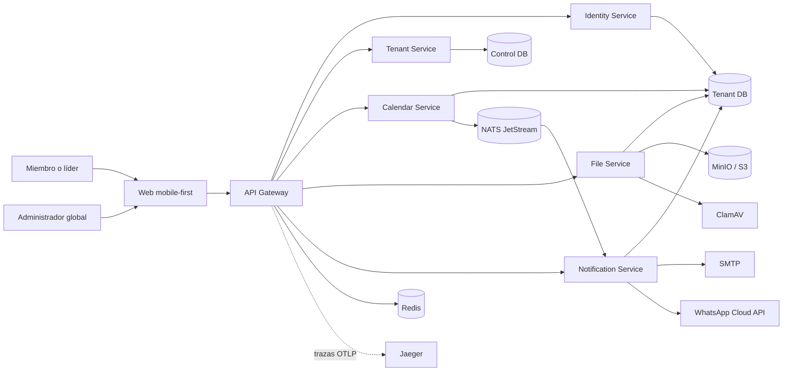
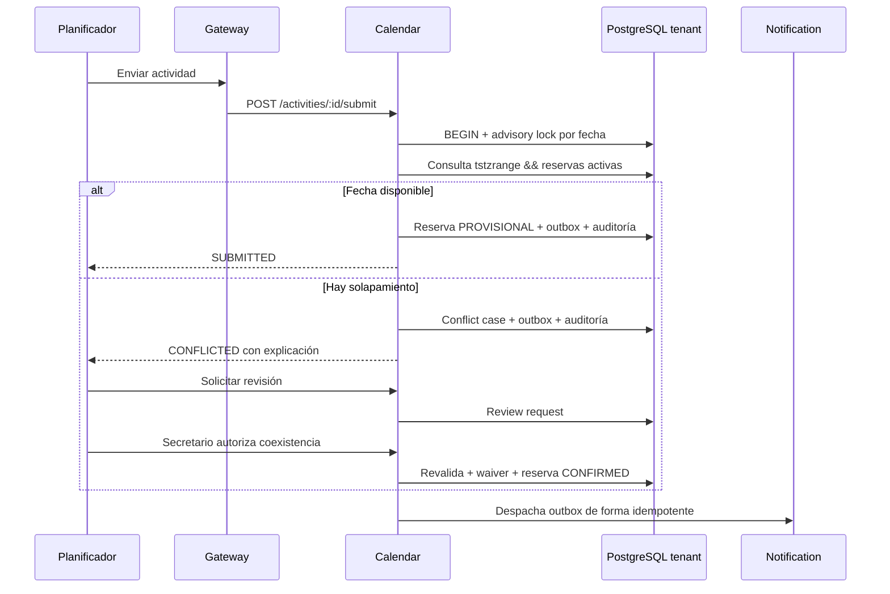

# Arquitectura

El módulo de reportes opera como el microservicio independiente `reports-service` (puerto interno 4016). El API Gateway publica `/api/v1/reports/*`; el servicio valida la sesión y los permisos del tenant, abre exclusivamente la base física del tenant autenticado y expone analítica agregada, CSV y PDF ejecutivo sin compartir datos entre iglesias.

## Contexto

## Límites

- El navegador nunca llama directamente a un microservicio ni a PostgreSQL.
- El Gateway es el único punto de entrada y propaga cookie de sesión, CORS y correlation ID.
- Identity resuelve el tenant desde el registro global y valida credenciales en su base.
- Calendar es dueño del estado de actividades, opciones, sesiones, reservas y decisiones.
- File almacena IDs opacos de actividad y valida actualmente su existencia mediante una lectura restringida en la base física del mismo tenant; separar esa validación detrás de un contrato interno es un hardening previsto antes de dividir credenciales PostgreSQL por servicio.
- Calendar publica un outbox transaccional en NATS JetStream; en desarrollo sin NATS utiliza entrega HTTP interna idempotente.
- Notification deduplica por `event_id`.

## Flujo de conflicto

## Persistencia

Existe `gestionchurch_control` para routing/provisionamiento. Cada tenant usa `gc_tenant_<uuid>` y contiene esquemas separados:

- `identity`
- `calendar`
- `files`
- `notifications`
- `audit`

La separación física impide que un error de filtro `tenant_id` exponga otra iglesia. Los caches, buckets, métricas y colas futuras también deben namespacerse con el tenant validado.

El modo nativo usa una credencial local para abrir la conexión, pero cada proceso ejecuta la sesión bajo un rol PostgreSQL `NOLOGIN` distinto (`gc_identity_service`, `gc_calendar_service`, `gc_file_service` o `gc_notification_service`) con grants mínimos. La suite demuestra que File no puede modificar Calendar y que Identity no puede leer Files. En producción cada servicio debe recibir además un login rotatorio propio con membresía exclusiva en su rol, evitando compartir la credencial de conexión administrativa.
